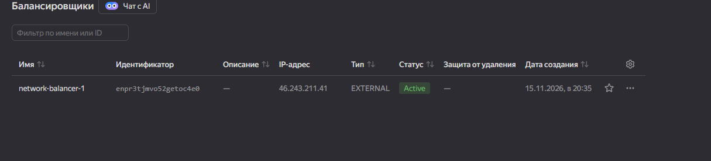
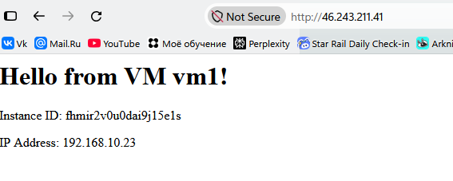
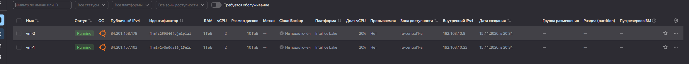

# Домашнее задание к занятию «Отказоустойчивость в облаке» - `Горячев Павел`


## Задание 1 

Возьмите за основу [решение к заданию 1 из занятия «Подъём инфраструктуры в Яндекс Облаке»](https://github.com/netology-code/sdvps-homeworks/blob/main/7-03.md#задание-1).

1. Теперь вместо одной виртуальной машины сделайте terraform playbook, который:

- создаст 2 идентичные виртуальные машины. Используйте аргумент [count](https://www.terraform.io/docs/language/meta-arguments/count.html) для создания таких ресурсов;
- создаст [таргет-группу](https://registry.terraform.io/providers/yandex-cloud/yandex/latest/docs/resources/lb_target_group). Поместите в неё созданные на шаге 1 виртуальные машины;
- создаст [сетевой балансировщик нагрузки](https://registry.terraform.io/providers/yandex-cloud/yandex/latest/docs/resources/lb_network_load_balancer), который слушает на порту 80, отправляет трафик на порт 80 виртуальных машин и http healthcheck на порт 80 виртуальных машин.

Рекомендуем изучить [документацию сетевого балансировщика нагрузки](https://cloud.yandex.ru/docs/network-load-balancer/quickstart) для того, чтобы было понятно, что вы сделали.

2. Установите на созданные виртуальные машины пакет Nginx любым удобным способом и запустите Nginx веб-сервер на порту 80.

3. Перейдите в веб-консоль Yandex Cloud и убедитесь, что: 

- созданный балансировщик находится в статусе Active,
- обе виртуальные машины в целевой группе находятся в состоянии healthy.


4. Сделайте запрос на 80 порт на внешний IP-адрес балансировщика и убедитесь, что вы получаете ответ в виде дефолтной страницы Nginx.


*В качестве результата пришлите:*

*1. Terraform Playbook.*

*2. Скриншот статуса балансировщика и целевой группы.*

*3. Скриншот страницы, которая открылась при запросе IP-адреса балансировщика.*

---
Основной файл плейбука terraform (такжее лежит в ./terraform)
```

#считываем данные об образе ОС
data "yandex_compute_image" "ubuntu_2204_lts" {
  family = "ubuntu-2204-lts"
}

terraform {
  required_providers {
    yandex = {
      source = "yandex-cloud/yandex"
      version = "0.83.0"
    }
  }
}

provider "yandex" {
  service_account_key_file = var.service_account_key_file
  cloud_id                 = var.yc_cloud_id
  folder_id                = var.yc_folder_id
}

# Создаем сеть
resource "yandex_vpc_network" "network-1" {
  name = "network1"
}

# Создаем подсеть
resource "yandex_vpc_subnet" "subnet-1" {
  name           = "subnet1"
  zone           = var.yc_zone
  network_id     = yandex_vpc_network.network-1.id
  v4_cidr_blocks = ["192.168.10.0/24"]
}

# Создаем 2 идентичные ВМ с использованием count
resource "yandex_compute_instance" "vm" {
  count = 2

  name        = "vm-${count.index + 1}"
  platform_id = "standard-v3"
  zone        = var.yc_zone

   resources {
    cores         = 2
    memory        = 1
    core_fraction = 20
  }

  boot_disk {
    initialize_params {
      image_id = data.yandex_compute_image.ubuntu_2204_lts.image_id
      type     = "network-hdd"
      size     = 10
    }
  }

  network_interface {
    subnet_id = yandex_vpc_subnet.subnet-1.id
    nat       = true
  }

  metadata = {
    ssh-keys = "ubuntu:${var.public_key}"
  }
}

# Создаем целевую группу
resource "yandex_lb_target_group" "target-group-1" {
  name      = "target-group-1"
  region_id = var.yc_region

  target {
    subnet_id = yandex_vpc_subnet.subnet-1.id
    address   = yandex_compute_instance.vm[0].network_interface.0.ip_address
  }

  target {
    subnet_id = yandex_vpc_subnet.subnet-1.id
    address   = yandex_compute_instance.vm[1].network_interface.0.ip_address
  }
}

# Создаем сетевой балансировщик нагрузки
resource "yandex_lb_network_load_balancer" "balancer-1" {
  name = "network-balancer-1"
  listener {
    name        = "listener-1"
    port        = 80
    protocol    = "tcp"
    target_port = 80
  }

  attached_target_group {
    target_group_id = yandex_lb_target_group.target-group-1.id

    healthcheck {
      name        = "http-healthcheck"
      http_options {
        port = 80
        path = "/"
      }
    }
  }
}
```



